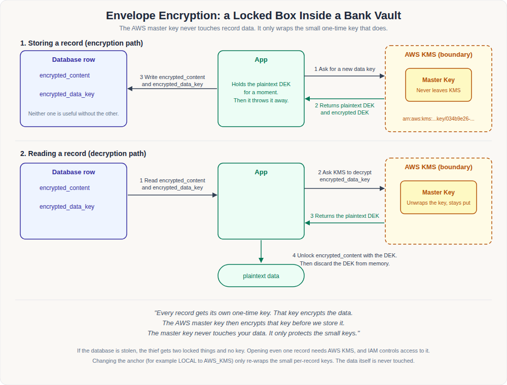

# TSI Privacy Vault Architecture

This document explains how the vault protects data, how records are searched
without being decrypted, how the root key anchor is managed, and where the key
management design is heading. It is the single reference for design and
roadmap. Operational runbooks live alongside it:

- [aws-kms-configuration.md](aws-kms-configuration.md): step-by-step AWS KMS setup.
- [tests/test-cases.md](../tests/test-cases.md): functional test cases for the key management flows.
- [tests/README.md](../tests/README.md): JMeter load test for the data plane.

## Contents

1. [Overview](#1-overview)
2. [Envelope encryption](#2-envelope-encryption)
3. [Blind index search](#3-blind-index-search)
4. [Key anchors and the key ring](#4-key-anchors-and-the-key-ring)
5. [Request path and fail-closed behavior](#5-request-path-and-fail-closed-behavior)
6. [Forensic evidence](#6-forensic-evidence)
7. [Roadmap](#7-roadmap)

---

## 1. Overview

The vault is a Java servlet application (Jetty) backed by PostgreSQL. Client
applications talk to a small REST data plane; administrators use a separate
admin console and API. Every sensitive value is encrypted before it reaches
the database, and the keys that protect it are themselves protected by a
root key anchor.

| Concern | Mechanism |
|---|---|
| Confidentiality at rest | Per-record Data Encryption Key (DEK), AES encryption done locally |
| Key protection | DEK wrapped by a root key anchor (LOCAL master key or AWS KMS CMK) |
| Searchability | Deterministic keyed hash (blind index), no decryption needed |
| Authentication and authorization | API key and secret (PBKDF2-hashed at rest), then per-entity READ/WRITE permissions |
| Evidence | Every request logged with user, client and machine identity in `event_log` |

### Data flavours

| Flavour | Used for | Handling |
|---|---|---|
| `ID` | Aadhaar, Voter ID, ABHA ID, PAN | Tokenized: the caller gets a `reference_key`, a hash supports lookup by value |
| `DATA` | Names, addresses, medical records | Field-level encryption, blind index for search |
| `FILE` | Contracts, scans | Encrypted binary storage with size and MIME limits |

Utilities (API keys, service credentials, certificates) use the same
encryption machinery and are stored in `vault_utilities`, bound to a machine
identity as a hardware anchor.

### Main components

| Component | Role |
|---|---|
| `api/client/Vault.java` | Data plane: store, fetch, search, resolve |
| `api/admin/*` | Admin plane: login, entities, API keys, permissions, utilities, audit, key anchor |
| `framework/InterceptingFilter.java` | Routing, authentication, and the key anchor health gate |
| `framework/KmsProvider.java` | Contract every anchor implements: `generateDataKey`, `decryptDataKey`, `aesEncrypt`, `aesDecrypt` |
| `framework/KmsProviderFactory.java` | Single source of provider instances and the boot-time health check |
| `framework/VersionedKmsProvider.java` | Routes each record to the anchor that wrapped it, using `key_version` |
| `framework/KeyRing.java` | In-memory view of the `vault_key_ring` table |
| `framework/LocalKmsProvider.java`, `AwsKmsProvider.java` | The two shipped anchors |
| `framework/CipherUtil.java` | AES-GCM for new versions, AES-CBC retained for legacy records |
| `framework/ForensicEngine.java` | Machine identity and audit logging |

---

## 2. Envelope encryption



Every record is encrypted with its own one-time Data Encryption Key (DEK). The
DEK is then encrypted ("wrapped") by the root key anchor before it is stored.
The anchor's master key never touches record data directly. It only ever
protects the small keys that do.

**Storing a record**

1. The app asks the anchor for a new data key.
2. The anchor returns the DEK in two forms: plaintext, and wrapped.
3. The app encrypts the payload locally with the plaintext DEK and discards it.
4. The row is written with `encrypted_content` and `encrypted_data_key`,
   plus the `key_version` and `payload_cipher` used.

**Reading a record**

1. The app reads `encrypted_content` and `encrypted_data_key` from the row.
2. It asks the anchor named by the row's `key_version` to unwrap the DEK.
3. It decrypts the payload locally, then discards the DEK from memory.

**Why this matters**

- If the database is stolen, the attacker holds two locked things and no key
  that opens either. Unlocking even one record requires the anchor itself.
- With AWS KMS as the anchor, the anchor only ever sees a wrapped data key of
  about 48 bytes. Your data never leaves the vault process.
- Changing the anchor only re-wraps those small per-record keys. Payload
  ciphertext is never re-encrypted, so migration is cheap and resumable.

### Ciphers

| Cipher | Used for | Notes |
|---|---|---|
| `AES_CBC_PKCS5` | Legacy records (`key_version` 1 under the LOCAL anchor) | Kept readable for backward compatibility |
| `AES_GCM` | All records written under newer key versions | 12-byte nonce, 128-bit tag, authenticated |

The cipher is recorded per row in `payload_cipher`, so old and new records
coexist during migration.

---

## 3. Blind index search


Encrypted content uses a random IV per record, so it can never be searched
directly. To make lookups possible without decryption, the vault maintains a
separate inverted index of keyed hashes in `vault_search_index`.

**Indexing a record (write time)**

1. The plaintext value is normalized (trimmed, upper-cased).
2. One token is produced per search shape:
   - `FULL`: the whole value.
   - `PART`: each word, when the value has more than one.
   - `PREFIX`: the first three characters.
3. Each token is hashed as `SHA-256(secret + token)`, where the secret is
   `TSI_PRIVACY_VAULT_INDEX_SECRET`, held only in the application environment.
4. A row `(index_hash, entity_ref, attribute_type)` is inserted. The row points
   at the encrypted record but contains no data.

**Searching (query time)**

1. The search term is normalized and hashed with the same secret and recipe.
2. The hash is matched against `vault_search_index.index_hash`, an exact-match
   lookup with no decryption.
3. Matches are filtered through `isAuthorized(apiKey, entity_code)`, which
   drops anything the caller has no READ permission for.
4. The caller receives `reference_key` and `flavor`, not the plaintext. Reading
   the value still needs a fetch and the key unwrap path from section 2.

**Properties**

- The hash is deterministic on purpose: that is what makes equality lookup work.
- Without the index secret, even a correct guess at the plaintext does not
  produce a matching hash, so the index resists offline dictionary attacks.
- Treat `TSI_PRIVACY_VAULT_INDEX_SECRET` as a long-lived secret. Changing it
  invalidates the existing index.

---

## 4. Key anchors and the key ring

A root key anchor is whatever protects the DEKs at rest. The data plane never
knows which anchor is in use. It talks only to `KmsProvider`.

| Anchor | Status | Root key | Best for |
|---|---|---|---|
| `LOCAL` | Shipped (default) | `TSI_PRIVACY_VAULT_MASTER_KEY`, SHA-256 normalized to 32 bytes, held in process memory | Evaluation, on-prem and air-gapped deployments |
| `AWS_KMS` | Shipped in v0.2.0 | AWS KMS Customer Managed Key, never leaves AWS | Production deployments wanting cloud HSM custody, rotation and CloudTrail |
| `GCP_KMS`, `AZURE_KV` | Planned, on demand (Cloud track) | Cloud KMS CryptoKey, Key Vault key | Multi-cloud parity |
| `SHAMIR` | Planned (Sovereign track) | K-of-N custodian shares | Air-gapped, no-single-person-unlock deployments |
| `PKCS11` | Candidate (Sovereign track) | Key in an on-prem HSM, accessed through PKCS#11 | Air-gapped deployments that require validated hardware |

### LOCAL vs AWS KMS

Out of the box, with no extra setup, the vault runs on the LOCAL anchor: the
master key in your `.env` file. This is what the Docker install gives you, and
it is all you need to evaluate the vault or run it fully on-prem or air-gapped.
AWS KMS is opt-in, a one-time migration you run later if you want the root key
held in an AWS-managed HSM instead of an environment variable. You do not need
AWS at all to use the vault.

| | LOCAL (default) | AWS KMS (opt-in) |
|---|---|---|
| Root key | `TSI_PRIVACY_VAULT_MASTER_KEY` env var (SHA-256 normalized, held in process memory) | AWS KMS Customer Managed Key, never leaves AWS |
| Best for | Local evaluation, air-gapped and on-prem deployments | Production deployments wanting cloud HSM custody, automatic rotation and CloudTrail audit logging |
| Setup | Works out of the box via `.env` | One-time: create the CMK, attach a least-privilege IAM policy, activate the anchor and re-wrap existing records from the Key Anchor page |

Payload ciphertext is always decrypted locally either way. AWS only ever sees a
wrapped data key of about 48 bytes, never your data.

### The key ring

`vault_key_ring` records every anchor generation the vault has used.

| Column | Meaning |
|---|---|
| `key_version` | Serial version number, referenced by every wrapped record |
| `anchor_type` | `LOCAL`, `AWS_KMS`, and future values |
| `anchor_ref` | Cloud key ARN or resource name, `NULL` for local |
| `cipher` | Payload cipher for records written under this version |
| `status` | `ACTIVE`, `DECRYPT_ONLY` or `RETIRED` |

Rules:

- Exactly one version is `ACTIVE` at a time (enforced by a partial unique index).
  It wraps all new DEKs.
- `DECRYPT_ONLY` versions can still unwrap existing records but never wrap new
  ones.
- `RETIRED` versions are no longer referenced by any row.
- `vault_entities` and `vault_utilities` carry `key_version` and
  `payload_cipher`, so each record says which anchor and cipher protect it.

### Switching anchors

1. Configure the new anchor (for AWS KMS: region, key ARN, IAM policy).
2. Activate it from the Key Anchor page (`activate_key_anchor`). The vault
   first performs a `GenerateDataKey` plus `Decrypt` round trip, and only then
   creates the new ACTIVE version and demotes the old one to `DECRYPT_ONLY`.
3. Run the re-wrap job (`rewrap_data_keys`) in batches until nothing is
   pending. Each row's DEK is unwrapped under the old version and wrapped under
   the new one. The final pass retires the old version.
4. Remove the old root key material from the environment.

Existing records stay readable throughout. See
[aws-kms-configuration.md](aws-kms-configuration.md) for the full runbook.

### What re-wrap is, and why it is a separate step

Every record's payload is encrypted with its own one-time DEK, and that DEK is
wrapped by whichever anchor was active when the record was written: LOCAL at
first, AWS KMS once you switch. Re-wrap unwraps each record's DEK under the old
anchor and wraps it under the new one, so old records become readable under the
new anchor too. It touches only that small wrapped key. The payload ciphertext
is never re-encrypted, so re-wrapping a large vault is cheap.

Activation and re-wrap are separate because activating a new anchor only
affects new writes. Existing records keep pointing at the old key version until
you migrate them. Re-wrap does that in batches, resumable, while the vault stays
online, and retires the old version when nothing references it. It runs from
the Key Anchor page (**Rewrap Data Keys**, **Run Batch**) or through the
`rewrap_data_keys` admin API call.

### AWS KMS specifics

- Region and key come from `TSI_PRIVACY_VAULT_AWS_REGION` and
  `TSI_PRIVACY_VAULT_AWS_KMS_KEY_ID`. Credentials use the AWS default chain
  (instance profile, task role, or environment).
- Every KMS call carries the encryption context
  `vault_node_id=<TSI_PRIVACY_VAULT_NODE_ID>`, binding wrapped keys to this
  vault instance and enriching CloudTrail. Do not change the node ID after
  activation.
- A single shared KMS client is built once and reused. Throttling is retried
  with backoff.
- The IAM policy needs only `kms:GenerateDataKey`, `kms:Decrypt` and
  `kms:Encrypt` (the last only for the re-wrap job), scoped to one key.

---

## 5. Request path and fail-closed behavior

`InterceptingFilter` sits in front of every API call.

1. The request path is resolved against the processor registry.
2. Admin endpoints (other than login, reset and setup) require a valid admin
   JWT. Client endpoints require an API key and secret.
3. Data-plane requests (`api/client` and `api/admin/utility`) are rejected with
   `503 Vault key anchor unavailable` while the key anchor health check is
   failing.
4. The request is dispatched to the processor, which enforces per-entity
   permissions through the `permissions` table.

### Boot health gate

At startup, `KmsProviderFactory.healthCheck()` loads the key ring and runs a
`GenerateDataKey` plus `Decrypt` round trip against the ACTIVE anchor.

- On success the data plane opens.
- On failure the data plane stays closed (no degraded read-only mode) and the
  failure is written to `event_log` as `KMS_HEALTH_CHECK` with outcome `ERROR`.
- Admin login and status stay reachable. After fixing the cause, **Refresh** on
  the Key Anchor page re-runs the check and reopens the data plane without a
  restart.

If `TSI_PRIVACY_VAULT_KMS_PROVIDER` differs from the ACTIVE ring anchor, the
vault logs a warning. Configuration alone never changes the wrapping anchor.

---

## 6. Forensic evidence

Every request is recorded in `event_log`: who, operation type, entity code and
reference, client IP, user agent, machine identifier, outcome (`SUCCESS`,
`DENIED`, `ERROR`) and a failure reason. The machine identifier acts as a
hardware anchor, so each action is tied to a user and a device. This is the
basis for the audit trail and the BSA Section 63 certificate output. Key
operations (anchor activation, re-wrap, KMS failures) use the same logging
path.

---

## 7. Roadmap

The vault supports two deployment tracks. Both are supported today. They
evolve independently, and the next phase extends each one.

| Track | For | Shipped today | Next phase |
|---|---|---|---|
| **Sovereign** | On-prem and air-gapped environments, no public cloud | `LOCAL` anchor | `SHAMIR` split key (K-of-N custodians), `PKCS11` HSM if required |
| **Cloud** | Deployments that want a managed, HSM-backed root key | `AWS_KMS` anchor | `GCP_KMS` and `AZURE_KV`, added on demand |

A deployment picks one track. Switching tracks later is an anchor migration,
and only the small wrapped DEKs are re-wrapped.

### Status

| Milestone | Track | Contents | Status |
|---|---|---|---|
| M0 | Both | Provider factory, fail-closed local key, key ring schema, AES-GCM, removal of the legacy KMS prototype | Shipped |
| M1 | Cloud | AWS KMS provider: env config, default credential chain, encryption context, health check, retries | Shipped (v0.2.0) |
| M2 | Both | `activate_key_anchor`, LOCAL to AWS re-wrap job, IAM docs, anchor status in the admin console | Shipped (v0.2.0) |
| M3 | Sovereign | Shamir split-key: split and combine, `SealManager`, seal-aware filter, key ceremony, unseal and seal APIs | Planned |
| M4 | Cloud | GCP KMS or Azure Key Vault provider, shared cloud provider base class, anchor migration runbook | Planned, on demand |

The two next-phase items are independent. They can ship in either order.
Build the cloud provider that a real user asks for first. The shared base class
makes the second one small.

Later additions, not scheduled:
- Shamir admin UI, custodian audit and rekey.
- `PKCS11` anchor (Sovereign track) for air-gapped deployments that require a
  validated HSM. It is another provider behind `KmsProvider`, so the data
  plane does not change.

### Design principles

- Anchors differ only in how DEKs are protected at rest. The data plane is
  anchor-agnostic and talks only to `KmsProvider`.
- Every wrapped DEK records the key version that wrapped it, enabling rotation
  and anchor migration without a one-shot re-encryption.
- Payload ciphertext is never bulk re-encrypted during migration. Only the
  wrapped DEK is re-wrapped.

```
                 +--------------------------------------------+
                 |              Root Key Anchors              |
                 |                                            |
   Shipped  ->   |  LOCAL    : master key from environment    |
   Shipped  ->   |  AWS_KMS  : AWS KMS CMK                    |
   Next     ->   |  GCP_KMS  : Cloud KMS CryptoKey            |
   Next     ->   |  AZURE_KV : Key Vault / Managed HSM key    |
   Next     ->   |  SHAMIR   : K-of-N custodian shares        |
                 +---------------------+----------------------+
                                       | wraps (with key_version)
                                       v
                 +--------------------------------------------+
                 |  Per-record Data Encryption Keys (DEKs)    |
                 |  stored as encrypted_data_key              |
                 +--------------------------------------------+
```

### Phases 0 and 1: delivered

Phase 0 introduced the provider factory, key ring and key version metadata,
the fail-closed boot gate, and AES-GCM for new versions. Phase 1 delivered the
AWS KMS anchor, the activation flow and the resumable re-wrap migration. Their
behavior is described in sections 4 and 5, and the changelog records the
release contents.

Known follow-ups carried over from this work:

- Fold the existing utility `rotate` admin function into the key-version
  mechanism, so that rotation means a new key ring version under the same
  anchor plus re-wrap.
- Keep `TSI_PRIVACY_VAULT_NODE_ID` stable. It is part of the KMS encryption
  context and the utility hardware anchor.

### Cloud track next: Google Cloud KMS and Azure Key Vault

Both reuse the Phase 1 (AWS) machinery: factory, key ring, re-wrap migration, health
checks and forensic logging. Shared concerns move into an
`AbstractCloudKmsProvider` extracted from the AWS provider.

**Google Cloud KMS (`GcpKmsProvider`)**

- Dependency: `com.google.cloud:google-cloud-kms`.
- GCP KMS has no `GenerateDataKey` API. The 32-byte DEK is generated locally
  with `SecureRandom`, then encrypted under the CryptoKey with
  `additionalAuthenticatedData`.
- Config: `TSI_PRIVACY_VAULT_GCP_KMS_KEY_RESOURCE`. Auth through Application
  Default Credentials or workload identity.
- Required role: `roles/cloudkms.cryptoKeyEncrypterDecrypter`.

**Azure Key Vault (`AzureKvProvider`)**

- Dependencies: `com.azure:azure-security-keyvault-keys` and
  `com.azure:azure-identity`.
- The DEK is generated locally and protected with `wrapKey` and `unwrapKey`
  (`RSA-OAEP-256`, or `AES-KW` on Managed HSM for symmetric parity).
- Config: `TSI_PRIVACY_VAULT_AZURE_KEY_ID` (full key identifier URL). Auth
  through `DefaultAzureCredential`, with managed identity preferred.
- Required permissions: `wrapKey` and `unwrapKey` only.

**Packaging.** Adding the GCP and Azure SDKs to the WAR is acceptable at first.
If size becomes a concern, introduce Maven profiles (`-Pkms-aws`, `-Pkms-gcp`,
`-Pkms-azure`) with reflective provider loading so the default build stays lean
and fully sovereign.

**Cross-cloud migration.** Switching anchors (for example AWS_KMS to GCP_KMS)
uses the same flow as section 4: activate a new key ring version, run the
re-wrap job, retire the old version. No payload re-encryption is ever needed.

### Sovereign track next: split key orchestration (Shamir's Secret Sharing)

For fully sovereign deployments where no cloud dependency is acceptable and no
single individual or compromised server may unlock the vault alone.

**Concept.** A randomly generated 32-byte Vault Master Key (VMK), never
derived from a passphrase, is split into N shares given to named custodians.
Any K shares (the threshold) reconstruct it. The server stores only wrapped
material, never the VMK. The vault gains an explicit lifecycle:
`UNINITIALIZED -> SEALED -> UNSEALED`. While SEALED, data-plane and utility
APIs return `503 Vault Sealed`, while admin login, status and unseal endpoints
stay available. After every restart the vault starts SEALED, by design.

**Cryptography**

- A `ShamirSecretSharing` class performing split and combine over GF(256), one
  byte at a time, with each share a point set on a random degree K-1
  polynomial. An in-repo implementation keeps the minimal-dependency posture.
  The alternative is vendoring `com.codahale:shamir` (Apache-2.0).
- Shares are encoded as `TSIV1-<share_index>-<base64(share)>-<crc32>` so
  custodians can detect typos at entry.
- The server persists only SHA-256 fingerprints of shares, N, K and custodian
  labels, never share material.

**Components and schema**

- `SealManager` (singleton) holds the VMK in memory only, collects shares,
  reconstructs the VMK on K valid distinct shares, verifies a stored check
  value, and zeroes the key on `seal()`. `InterceptingFilter` consults it and
  rejects data-plane requests while SEALED.
- `ShamirKmsProvider` wraps and unwraps like the local provider, sourcing the
  master key from `SealManager`, with AES-GCM.

```sql
CREATE TABLE vault_seal_config (
    id              SMALLINT PRIMARY KEY DEFAULT 1,
    share_count     SMALLINT NOT NULL,       -- N (2..16)
    threshold       SMALLINT NOT NULL,       -- K (2..N)
    vmk_check_value VARCHAR(64) NOT NULL,
    initialized_at  TIMESTAMP NOT NULL
);

CREATE TABLE vault_key_custodians (
    share_index       SMALLINT PRIMARY KEY,
    custodian_label   VARCHAR(120) NOT NULL, -- name or role only
    share_fingerprint VARCHAR(64) NOT NULL,  -- SHA-256 of share, for audit
    issued_at         TIMESTAMP NOT NULL
);
```

**Admin API surface**

| `_func` | Behavior |
|---|---|
| `init_split_key` | One-time key ceremony. Takes N, K and custodian labels, generates the VMK, returns the N shares once, stores fingerprints and the check value, and activates a new `SHAMIR` key ring entry. |
| `submit_unseal_share` | Accepts one share and returns progress. Every attempt is forensic-logged with custodian index, IP, user agent and outcome. |
| `get_seal_status` | `UNINITIALIZED`, `SEALED` or `UNSEALED`, with progress and active key version. Safe without authentication, since it returns no secrets. |
| `seal_vault` | Admin only. Zeroes the VMK and returns the vault to SEALED. |
| `rekey_shares` | Requires K fresh shares plus an admin JWT. Generates a new VMK, re-wraps all DEKs through the re-wrap job, and issues new shares. Also used to change N and K or revoke a custodian. |

The UI gains a key ceremony step in setup (display shares once, require
per-custodian acknowledgment), an unseal page for status and share
submission, and a seal-state badge on the dashboard.

**Security and operations**

- Shares are submitted over HTTPS only. Failed submissions are rate-limited
  and forensic-logged.
- Loss of more than N-K shares is unrecoverable by design. Recommended
  configuration is N of at least 5 with K = 3, held by geographically separate
  custodians. The existing `break_glass_reset` covers admin passwords only.
- Migration from any prior anchor uses the standard re-wrap flow.

### Testing expectations for remaining phases

- **Unit:** wrap and unwrap round trips per provider; legacy CBC blobs still
  decrypt after upgrade; for Shamir, GF(256) split and combine for all K-of-N
  up to 16, and a property test that K-1 shares fail the check value.
- **Integration:** GCP and Azure through emulators or mocked clients; anchor
  activation and re-wrap resumability (kill mid-batch); for Shamir, seal,
  unseal, store, seal, fetch returns 503, unseal, fetch.
- **Forensics:** every anchor activation, re-wrap, KMS failure and unseal
  attempt appears in `event_log` with the machine anchor.
- **Docs:** README, `.example`, `docker-compose.yml`, the tour and the user
  guide updated per phase.
