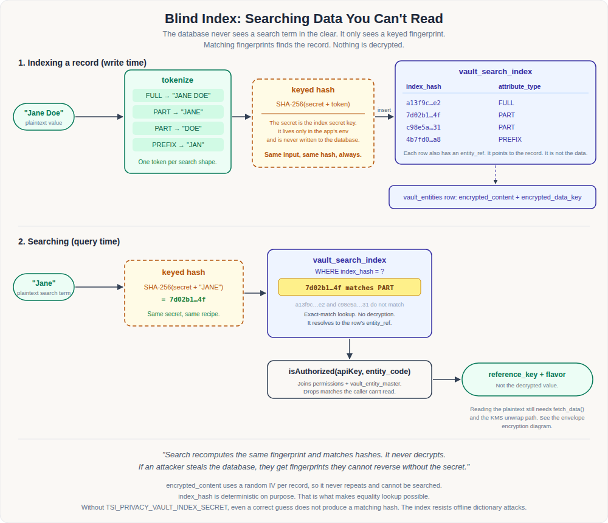

# TSI Privacy Vault Architecture

This document explains how the vault protects data, how records are searched
without being decrypted, how the root key anchor is managed, and where the key
management design is heading. It is the single reference for design and
roadmap. Operational runbooks live alongside it:

- [api-integration.md](../guides/api-integration.md): integrating applications with store, fetch and search.
- [aws-kms-configuration.md](../guides/aws-kms-configuration.md): step-by-step AWS KMS setup.
- [aws-s3-configuration.md](../guides/aws-s3-configuration.md): step-by-step S3 and S3-compatible file storage setup.
- [erasure-management.md](../guides/erasure-management.md): operating erasure by principal, from the policy hold to the certificate.
- [tests/test-cases.md](../../tests/test-cases.md): functional test cases for the key management flows.
- [tests/README.md](../../tests/README.md): JMeter load test for the data plane.

## Contents

1. [Overview](#1-overview)
2. [Envelope encryption](#2-envelope-encryption)
3. [Blind index search](#3-blind-index-search)
4. [Key anchors and the key ring](#4-key-anchors-and-the-key-ring)
5. [Request path and fail-closed behavior](#5-request-path-and-fail-closed-behavior)
6. [Forensic evidence](#6-forensic-evidence)
   - [Tamper-evident audit log](#tamper-evident-audit-log)
   - [Admin roles](#admin-roles)
7. [Roadmap](#7-roadmap)
   - [Storage backends](#storage-backends-next-pluggable-file-storage)
   - [Per-principal keys and crypto-erasure](#compliance-next-per-principal-keys-and-crypto-erasure)
   - [Consent manager integration](#compliance-next-consent-manager-integration)

---

## 1. Overview

The vault is a Java servlet application (Jetty) backed by PostgreSQL. Client
applications talk to a small REST data plane; administrators use a separate
admin console and API. Every sensitive value is encrypted before it reaches
the database, and the keys that protect it are themselves protected by a
root key anchor.

| Concern | Mechanism |
|---|---|
| Confidentiality at rest | Per-record Data Encryption Key (DEK), AES encryption done locally |
| Key protection | DEK wrapped by a root key anchor (LOCAL master key or AWS KMS CMK) |
| Searchability | Deterministic keyed hash (blind index), no decryption needed |
| Authentication and authorization | API key and secret (PBKDF2-hashed at rest), then per-entity READ/WRITE permissions |
| Evidence | Every request logged with user, client and machine identity in `event_log`, hash-chained and append-only |

### Data flavours

| Flavour | Used for | Handling |
|---|---|---|
| `ID` | Aadhaar, Voter ID, ABHA ID, PAN | Tokenized: the caller gets a `reference_key`, a hash supports lookup by value |
| `DATA` | Names, addresses, medical records | Field-level encryption, blind index for search |
| `FILE` | Contracts, scans | Encrypted binary storage with size and MIME limits |

Utilities (API keys, service credentials, certificates) use the same
encryption machinery and are stored in `vault_utilities`, bound to a machine
identity as a hardware anchor.

### Main components

| Component | Role |
|---|---|
| `api/client/Vault.java` | Data plane: store, fetch, search, resolve |
| `api/admin/*` | Admin plane: login, entities, API keys, permissions, utilities, audit, key anchor |
| `framework/InterceptingFilter.java` | Routing, authentication, and the key anchor health gate |
| `framework/KmsProvider.java` | Contract every anchor implements: `generateDataKey`, `decryptDataKey`, `aesEncrypt`, `aesDecrypt` |
| `framework/KmsProviderFactory.java` | Single source of provider instances and the boot-time health check |
| `framework/VersionedKmsProvider.java` | Routes each record to the anchor that wrapped it, using `key_version` |
| `framework/KeyRing.java` | In-memory view of the `vault_key_ring` table |
| `framework/LocalKmsProvider.java`, `AwsKmsProvider.java` | The two shipped anchors |
| `framework/CipherUtil.java` | AES-GCM for new versions, AES-CBC retained for legacy records |
| `framework/ForensicEngine.java` | Machine identity and audit logging |
| `framework/RoleGuard.java` | Admin role check: mutating functions need `SYSTEM_ADMIN`, denials are audited |
| `db/04_audit_chain.sql` | Hash chain, append-only guard and chain verification for `event_log` |

---

## 2. Envelope encryption


Every record is encrypted with its own one-time Data Encryption Key (DEK). The
DEK is then encrypted ("wrapped") by the root key anchor before it is stored.
The anchor's master key never touches record data directly. It only ever
protects the small keys that do.

**Storing a record**

1. The app asks the anchor for a new data key.
2. The anchor returns the DEK in two forms: plaintext, and wrapped.
3. The app encrypts the payload locally with the plaintext DEK and discards it.
4. The row is written with `encrypted_content` and `encrypted_data_key`,
   plus the `key_version` and `payload_cipher` used.

**Reading a record**

1. The app reads `encrypted_content` and `encrypted_data_key` from the row.
2. It asks the anchor named by the row's `key_version` to unwrap the DEK.
3. It decrypts the payload locally, then discards the DEK from memory.

**Why this matters**

- If the database is stolen, the attacker holds two locked things and no key
  that opens either. Unlocking even one record requires the anchor itself.
- With AWS KMS as the anchor, the anchor only ever sees a wrapped data key of
  about 48 bytes. Your data never leaves the vault process.
- Changing the anchor only re-wraps those small per-record keys. Payload
  ciphertext is never re-encrypted, so migration is cheap and resumable.

### Ciphers

| Cipher | Used for | Notes |
|---|---|---|
| `AES_CBC_PKCS5` | Legacy records (`key_version` 1 under the LOCAL anchor) | Kept readable for backward compatibility |
| `AES_GCM` | All records written under newer key versions | 12-byte nonce, 128-bit tag, authenticated |

The cipher is recorded per row in `payload_cipher`, so old and new records
coexist during migration.

---

## 3. Blind index search



Encrypted content uses a random IV per record, so it can never be searched
directly. To make lookups possible without decryption, the vault maintains a
separate inverted index of keyed hashes in `vault_search_index`.

**Indexing a record (write time)**

1. The plaintext value is normalized (trimmed, upper-cased).
2. One token is produced per search shape:
   - `FULL`: the whole value.
   - `PART`: each word, when the value has more than one.
   - `PREFIX`: the first three characters.
3. Each token is hashed as `SHA-256(secret + token)`, where the secret is
   `TSI_PRIVACY_VAULT_INDEX_SECRET`, held only in the application environment.
4. A row `(index_hash, entity_ref, attribute_type)` is inserted. The row points
   at the encrypted record but contains no data.

**Searching (query time)**

1. The search term is normalized and hashed with the same secret and recipe.
2. The hash is matched against `vault_search_index.index_hash`, an exact-match
   lookup with no decryption.
3. Matches are filtered through `isAuthorized(apiKey, entity_code)`, which
   drops anything the caller has no READ permission for.
4. The caller receives `reference_key` and `flavor`, not the plaintext. Reading
   the value still needs a fetch and the key unwrap path from section 2.

**Properties**

- The hash is deterministic on purpose: that is what makes equality lookup work.
- Without the index secret, even a correct guess at the plaintext does not
  produce a matching hash, so the index resists offline dictionary attacks.
- Treat `TSI_PRIVACY_VAULT_INDEX_SECRET` as a long-lived secret. Changing it
  invalidates the existing index.

---

## 4. Key anchors and the key ring

A root key anchor is whatever protects the DEKs at rest. The data plane never
knows which anchor is in use. It talks only to `KmsProvider`.

| Anchor | Status | Root key | Best for |
|---|---|---|---|
| `LOCAL` | Shipped (default) | `TSI_PRIVACY_VAULT_MASTER_KEY`, SHA-256 normalized to 32 bytes, held in process memory | Evaluation, on-prem and air-gapped deployments |
| `AWS_KMS` | Shipped in v0.2.0 | AWS KMS Customer Managed Key, never leaves AWS | Production deployments wanting cloud HSM custody, rotation and CloudTrail |
| `GCP_KMS`, `AZURE_KV` | Planned, on demand (Cloud track) | Cloud KMS CryptoKey, Key Vault key | Multi-cloud parity |
| `OPENBAO` | Planned (Sovereign track) | Transit key in a customer-run OpenBao (or HashiCorp Vault) | On-prem and air-gapped deployments that need Shamir unseal, HSM sealing and central key policy |

### LOCAL vs AWS KMS

Out of the box, with no extra setup, the vault runs on the LOCAL anchor: the
master key in your `.env` file. This is what the Docker install gives you, and
it is all you need to evaluate the vault or run it fully on-prem or air-gapped.
AWS KMS is opt-in, a one-time migration you run later if you want the root key
held in an AWS-managed HSM instead of an environment variable. You do not need
AWS at all to use the vault.

| | LOCAL (default) | AWS KMS (opt-in) |
|---|---|---|
| Root key | `TSI_PRIVACY_VAULT_MASTER_KEY` env var (SHA-256 normalized, held in process memory) | AWS KMS Customer Managed Key, never leaves AWS |
| Best for | Local evaluation, air-gapped and on-prem deployments | Production deployments wanting cloud HSM custody, automatic rotation and CloudTrail audit logging |
| Setup | Works out of the box via `.env` | One-time: create the CMK, attach a least-privilege IAM policy, activate the anchor and re-wrap existing records from the Settings > Key Anchor tab |

Payload ciphertext is always decrypted locally either way. AWS only ever sees a
wrapped data key of about 48 bytes, never your data.

### The key ring

`vault_key_ring` records every anchor generation the vault has used.

| Column | Meaning |
|---|---|
| `key_version` | Serial version number, referenced by every wrapped record |
| `anchor_type` | `LOCAL`, `AWS_KMS`, and future values |
| `anchor_ref` | Cloud key ARN or resource name, `NULL` for local |
| `cipher` | Payload cipher for records written under this version |
| `status` | `ACTIVE`, `DECRYPT_ONLY` or `RETIRED` |

Rules:

- Exactly one version is `ACTIVE` at a time (enforced by a partial unique index).
  It wraps all new DEKs.
- `DECRYPT_ONLY` versions can still unwrap existing records but never wrap new
  ones.
- `RETIRED` versions are no longer referenced by any row.
- `vault_entities` and `vault_utilities` carry `key_version` and
  `payload_cipher`, so each record says which anchor and cipher protect it.

### Switching anchors

1. Configure the new anchor (for AWS KMS: region, key ARN, IAM policy).
2. Activate it from the Settings > Key Anchor tab (`activate_key_anchor`). The vault
   first performs a `GenerateDataKey` plus `Decrypt` round trip, and only then
   creates the new ACTIVE version and demotes the old one to `DECRYPT_ONLY`.
3. Run the re-wrap job (`rewrap_data_keys`) in batches until nothing is
   pending. Each row's DEK is unwrapped under the old version and wrapped under
   the new one. The final pass retires the old version.
4. Remove the old root key material from the environment.

Existing records stay readable throughout. See
[aws-kms-configuration.md](../guides/aws-kms-configuration.md) for the full runbook.

### What re-wrap is, and why it is a separate step

Every record's payload is encrypted with its own one-time DEK, and that DEK is
wrapped by whichever anchor was active when the record was written: LOCAL at
first, AWS KMS once you switch. Re-wrap unwraps each record's DEK under the old
anchor and wraps it under the new one, so old records become readable under the
new anchor too. It touches only that small wrapped key. The payload ciphertext
is never re-encrypted, so re-wrapping a large vault is cheap.

Activation and re-wrap are separate because activating a new anchor only
affects new writes. Existing records keep pointing at the old key version until
you migrate them. Re-wrap does that in batches, resumable, while the vault stays
online, and retires the old version when nothing references it. It runs from
the Settings > Key Anchor tab (**Rewrap Data Keys**, **Run Batch**) or through the
`rewrap_data_keys` admin API call.

### AWS KMS specifics

- Region and key come from `TSI_PRIVACY_VAULT_AWS_REGION` and
  `TSI_PRIVACY_VAULT_AWS_KMS_KEY_ID`. Credentials use the AWS default chain
  (instance profile, task role, or environment).
- Every KMS call carries the encryption context
  `vault_node_id=<TSI_PRIVACY_VAULT_NODE_ID>`, binding wrapped keys to this
  vault instance and enriching CloudTrail. Do not change the node ID after
  activation.
- A single shared KMS client is built once and reused. Throttling is retried
  with backoff.
- The IAM policy needs only `kms:GenerateDataKey`, `kms:Decrypt` and
  `kms:Encrypt` (the last only for the re-wrap job), scoped to one key.

---

## 5. Request path and fail-closed behavior

`InterceptingFilter` sits in front of every API call.

1. The request path is resolved against the processor registry.
2. Admin endpoints (other than login, reset and setup) require a valid admin
   JWT. Client endpoints require an API key and secret.
3. Data-plane requests (`api/client` and `api/admin/utility`) are rejected with
   `503 Vault key anchor unavailable` while the key anchor health check is
   failing.
4. The request is dispatched to the processor, which enforces per-entity
   permissions through the `permissions` table.

### Boot health gate

At startup, `KmsProviderFactory.healthCheck()` loads the key ring and runs a
`GenerateDataKey` plus `Decrypt` round trip against the ACTIVE anchor.

- On success the data plane opens.
- On failure the data plane stays closed (no degraded read-only mode) and the
  failure is written to `event_log` as `KMS_HEALTH_CHECK` with outcome `ERROR`.
- Admin login and status stay reachable. After fixing the cause, **Refresh** on
  the Settings > Key Anchor tab re-runs the check and reopens the data plane without a
  restart.

If `TSI_PRIVACY_VAULT_KMS_PROVIDER` differs from the ACTIVE ring anchor, the
vault logs a warning. Configuration alone never changes the wrapping anchor.

---

## 6. Forensic evidence

Every request is recorded in `event_log`: who, operation type, entity code and
reference, client IP, user agent, machine identifier, outcome (`SUCCESS`,
`DENIED`, `ERROR`) and a failure reason. The machine identifier acts as a
hardware anchor, so each action is tied to a user and a device. This is the
basis for the audit trail and the BSA Section 63 certificate output. Key
operations (anchor activation, re-wrap, KMS failures) use the same logging
path.

### Tamper-evident audit log

`event_log` is a hash chain. Each row stores `chain_seq`, `prev_hash` and
`row_hash`, where `row_hash = SHA-256(prev_hash | canonical row fields)`. The
canonical form covers every audited field, with the timestamp rendered in UTC so
a session time zone cannot change the result. The first row chains onto 64
zeros.

| Concern | Design |
|---|---|
| Who computes it | A `BEFORE INSERT` trigger in PostgreSQL, so every writer is covered and application code does not change. A caller cannot supply or skip a hash |
| Forks | The trigger takes a transaction-level advisory lock and assigns `chain_seq` under it, so concurrent writers form one chain. `chain_seq` has a unique index, and chain order is by it, not by `log_id`, because ids are handed out before the lock |
| Immutability | `BEFORE UPDATE`, `DELETE` and `TRUNCATE` triggers raise `event_log is append-only` |
| Verification | `verify_event_log_chain(from_seq)` recomputes each hash with the same function the trigger uses, and reports the first bad `chain_seq` and why: edited content, broken link, missing row, or a row written without the trigger. The admin API exposes it as `verify_audit_chain` on `/api/admin/audit` |
| Existing rows | Backfilled in `log_id` order when the script is applied. Earlier history is protected from that point on |

**What it proves, and what it does not.** The chain shows that no row was changed,
removed or re-ordered after it was written, unless the whole tail was rewritten.
It cannot, by itself, stop a database owner from disabling the triggers and
rewriting everything, or from dropping the newest rows. The head (`head_seq`,
`head_hash`) is returned on every verify so an operator can record it outside the
database. A later verify given that head fails if the row is missing or
different. Run the vault with a database role that does not own `event_log`, and
treat recorded heads as part of the evidence pack.

**Certificates.** The BSA Section 63 certificate carries an "Audit log integrity"
block: the sequence and hash of the certified event, the log head at issue, and
the time the chain was verified from that event to the head. Issuing verifies
first, and refuses with `409` if the chain is broken or the event is not in it.
The certificate holder therefore has an independent copy of the head: a later
rewrite of the log contradicts certificates already issued. The certified event
is the successful `STORE` event for the record, not whichever event came first.

**Cost.** Audit writes are serialized on one lock and each commits immediately.
Verification reads the whole log, so it is an off-peak or scheduled operation.
If a deployment outgrows this, the next step is periodic signed checkpoints
(a KMS signature over `head_hash`) so verification can start from the last
checkpoint. That is not built.

### Admin roles

Authentication is a valid admin JWT, checked for every `/api/admin/*` call in
`InterceptingFilter`. Authorization is a role carried in the token, enforced by
`RoleGuard` inside each admin action.

| Role | Allowed |
|---|---|
| `SYSTEM_ADMIN` | All reads, and every function that changes state or reveals a secret |
| Any other role (`AUDITOR`, `AUDIT_VIEWER`) | Reads only |

Rules the implementation follows:

- **Fail closed.** A function not in a read-only list is not assumed safe. Each
  action declares its mutating set, and a missing or unrecognised role is
  refused. New mutating functions must be added to that set. The unit test
  `RoleGuardTest` pins the decision logic.
- **Secrets count as writes.** `checkout` of a utility secret is gated like a
  write, because it returns plaintext.
- **User administration is `SYSTEM_ADMIN` only,** including `list_users`, except
  the two routes reachable without a login: `setup`, guarded by the bootstrap
  token and limited to creating the first `SYSTEM_ADMIN`, and `resetpass`,
  limited to `break_glass_reset` with the master recovery key.
- **Denials are evidence.** Every refusal returns `403` and writes `DENIED` to
  `event_log` as `ADMIN_<AREA>:<FUNCTION>` with reason `role`, so privilege
  probing is visible and is itself covered by the hash chain.
- **Erasure shares the model.** `Erasure.java` was the first to apply this check,
  and enforces the same `SYSTEM_ADMIN` rule. Its read functions (register, certificates)
  stay open to `AUDITOR`.

The model has two roles because that is what the console issues. Finer roles,
for example a key custodian who may rotate anchors but not edit entities, would
add a role name and change each action's mutating set. They are not built.

See the [Audit and access control guide](../guides/audit-and-access-control.md)
for operation.

---

## 7. Roadmap

The vault supports two deployment tracks. Both are supported today. They
evolve independently, and the next phase extends each one.

| Track | For | Shipped today | Next phase |
|---|---|---|---|
| **Sovereign** | On-prem and air-gapped environments, no public cloud | `LOCAL` anchor | `OPENBAO` anchor (Transit) |
| **Cloud** | Deployments that want a managed, HSM-backed root key | `AWS_KMS` anchor | `GCP_KMS` and `AZURE_KV`, added on demand |

A deployment picks one track. Switching tracks later is an anchor migration,
and only the small wrapped DEKs are re-wrapped.

File storage is a third, independent dimension. Where the encrypted bytes of a
`FILE` record live (the database today, or an object store such as S3 or GCS
later) does not depend on which key anchor is active. See
[Storage backends](#storage-backends-next-pluggable-file-storage).

Erasure is a fourth dimension, also independent of the anchor. Linking records
to a principal lets one data principal's records be made unrecoverable without touching
anyone else's. See
[Per-principal keys and crypto-erasure](#compliance-next-per-principal-keys-and-crypto-erasure).
The decision to erase comes from the consent manager, through a standardized
interface. See [Consent manager integration](#compliance-next-consent-manager-integration).

### Status

| Milestone | Track | Contents | Status |
|---|---|---|---|
| M0 | Both | Provider factory, fail-closed local key, key ring schema, AES-GCM, removal of the legacy KMS prototype | Shipped |
| M1 | Cloud | AWS KMS provider: env config, default credential chain, encryption context, health check, retries | Shipped (v0.2.0) |
| M2 | Both | `activate_key_anchor`, LOCAL to AWS re-wrap job, IAM docs, anchor status in the admin console | Shipped (v0.2.0) |
| M3 | Sovereign | OpenBao provider: Transit wrap and unwrap, AppRole auth, TLS, health check, LOCAL to OpenBao re-wrap, runbook | Planned |
| M4 | Cloud | GCP KMS or Azure Key Vault provider, shared cloud provider base class, anchor migration runbook | Planned, on demand |
| M5 | Storage | `FileStore` abstraction, `DATABASE` backend behind it (no behavior change), storage columns, `AWS_S3` and S3-compatible backend, health check | Implemented (v0.3.0, unreleased) |
| M6 | Storage | `GCS` and `AZURE_BLOB` backends, backend-to-backend migration job, runbook | Planned, on demand |
| M7 | Compliance | Per-principal keys: `principal_id` on store, Erasure Register (`principal_erasures`), a policy hold per entity type (`retain_days` from creation) and legal holds per principal, resumable partial `shred` that destroys all erasable DEKs linked to a principal and defers retained ones, erasure certificate | Implemented (v0.3.0, unreleased), see [Implementation notes](#erasure-implementation-notes). The consent manager (M8) takes over when erasure is due, and the policy hold stays |
| M8 | Compliance | Consent manager integration: the vault acts as a data processor on the standardized erasure interface. It polls the purge queue, performs a scoped shred per request, and reports fulfillment with an evidence hash. Retention timing becomes the consent manager's call. The vault keeps its policy hold for statutory periods | Design, see [Consent manager integration](#compliance-next-consent-manager-integration) |

The two next-phase key items are independent. They can ship in either order.
Build the cloud provider that a real user asks for first. The shared base class
makes the second one small. The storage milestones (M5 and M6) are independent
of both key tracks. M7 should land before M5 ships external storage, because
the purge path must also delete external objects, and that is easier to build
in than to retrofit.

### Design principles

- Anchors differ only in how DEKs are protected at rest. The data plane is
  anchor-agnostic and talks only to `KmsProvider`.
- Every wrapped DEK records the key version that wrapped it, enabling rotation
  and anchor migration without a one-shot re-encryption.
- Payload ciphertext is never bulk re-encrypted during migration. Only the
  wrapped DEK is re-wrapped.

```
                 +--------------------------------------------+
                 |              Root Key Anchors              |
                 |                                            |
   Shipped  ->   |  LOCAL    : master key from environment    |
   Shipped  ->   |  AWS_KMS  : AWS KMS CMK                    |
   Next     ->   |  GCP_KMS  : Cloud KMS CryptoKey            |
   Next     ->   |  AZURE_KV : Key Vault / Managed HSM key    |
   Next     ->   |  OPENBAO  : OpenBao / Vault Transit key    |
                 +---------------------+----------------------+
                                       | wraps (with key_version)
                                       v
                 +--------------------------------------------+
                 |  Per-record Data Encryption Keys (DEKs)    |
                 |  stored as encrypted_data_key              |
                 +--------------------------------------------+
```

### Phases 0 and 1: delivered

Phase 0 introduced the provider factory, key ring and key version metadata,
the fail-closed boot gate, and AES-GCM for new versions. Phase 1 delivered the
AWS KMS anchor, the activation flow and the resumable re-wrap migration. Their
behavior is described in sections 4 and 5, and the changelog records the
release contents.

Known follow-ups carried over from this work:

- Fold the existing utility `rotate` admin function into the key-version
  mechanism, so that rotation means a new key ring version under the same
  anchor plus re-wrap.
- Keep `TSI_PRIVACY_VAULT_NODE_ID` stable. It is part of the KMS encryption
  context and the utility hardware anchor.

### Cloud track next: Google Cloud KMS and Azure Key Vault

Both reuse the Phase 1 (AWS) machinery: factory, key ring, re-wrap migration, health
checks and forensic logging. Shared concerns move into an
`AbstractCloudKmsProvider` extracted from the AWS provider.

**Google Cloud KMS (`GcpKmsProvider`)**

- Dependency: `com.google.cloud:google-cloud-kms`.
- GCP KMS has no `GenerateDataKey` API. The 32-byte DEK is generated locally
  with `SecureRandom`, then encrypted under the CryptoKey with
  `additionalAuthenticatedData`.
- Config: `TSI_PRIVACY_VAULT_GCP_KMS_KEY_RESOURCE`. Auth through Application
  Default Credentials or workload identity.
- Required role: `roles/cloudkms.cryptoKeyEncrypterDecrypter`.

**Azure Key Vault (`AzureKvProvider`)**

- Dependencies: `com.azure:azure-security-keyvault-keys` and
  `com.azure:azure-identity`.
- The DEK is generated locally and protected with `wrapKey` and `unwrapKey`
  (`RSA-OAEP-256`, or `AES-KW` on Managed HSM for symmetric parity).
- Config: `TSI_PRIVACY_VAULT_AZURE_KEY_ID` (full key identifier URL). Auth
  through `DefaultAzureCredential`, with managed identity preferred.
- Required permissions: `wrapKey` and `unwrapKey` only.

**Packaging.** Adding the GCP and Azure SDKs to the WAR is acceptable at first.
If size becomes a concern, introduce Maven profiles (`-Pkms-aws`, `-Pkms-gcp`,
`-Pkms-azure`) with reflective provider loading so the default build stays lean
and fully sovereign.

**Cross-cloud migration.** Switching anchors (for example AWS_KMS to GCP_KMS)
uses the same flow as section 4: activate a new key ring version, run the
re-wrap job, retire the old version. No payload re-encryption is ever needed.

### Sovereign track next: OpenBao anchor

For on-prem and air-gapped deployments that want the root key outside the
vault process, with unseal workflows, HSM sealing and key policy handled by
infrastructure the customer already runs. OpenBao exposes a Vault-compatible
API, so the same provider should also work with HashiCorp Vault.

**Provider (`OpenBaoKmsProvider`)**

- Uses the Transit secrets engine. The 32-byte DEK is generated locally with
  `SecureRandom`, then wrapped with `POST /v1/<mount>/encrypt/<key>` and
  unwrapped with `POST /v1/<mount>/decrypt/<key>`. Plaintext is base64 on the
  wire.
- The Transit ciphertext (`vault:v<n>:...`) is stored as `encrypted_data_key`.
  The Transit key version travels inside it, so OpenBao-side rotation needs no
  schema change.
- The record's existing encryption context is passed as the Transit `context`
  value when the key is created with derivation enabled.
- Rotation of the Transit key can use the `rewrap` endpoint, which re-wraps a
  DEK inside OpenBao without returning plaintext. Anchor changes use the
  standard re-wrap job from section 4.
- A plain `java.net.http` client is enough. No SDK dependency is needed.

**Configuration**

| Variable | Meaning |
|---|---|
| `TSI_PRIVACY_VAULT_KMS_PROVIDER=OPENBAO` | Selects the anchor |
| `TSI_PRIVACY_VAULT_OPENBAO_ADDR` | Base URL. HTTPS only |
| `TSI_PRIVACY_VAULT_OPENBAO_TRANSIT_MOUNT` | Transit mount path, default `transit` |
| `TSI_PRIVACY_VAULT_OPENBAO_KEY_NAME` | Transit key name |
| `TSI_PRIVACY_VAULT_OPENBAO_CA_CERT` | Path to the CA certificate for private PKI |
| `TSI_PRIVACY_VAULT_OPENBAO_ROLE_ID`, `_SECRET_ID_FILE` | AppRole credentials. The secret ID is read from a file, not from `.env` |

**Security and operations**

- The vault logs in with AppRole, renews its token before expiry, and
  re-authenticates after a failure. The policy grants only `encrypt` and
  `decrypt` on the one Transit key.
- Unseal, HA, backup and audit of OpenBao belong to the operator. If OpenBao is
  sealed or unreachable, unwrap fails and the vault fails closed, the same as
  for AWS KMS. The boot health check surfaces this.
- The vault still holds each plaintext DEK in memory briefly, as it does with
  every anchor. Only the root key stays inside OpenBao.
- For validated hardware, the operator configures an HSM seal on the OpenBao
  side. The vault needs no change.
- Migration from LOCAL or AWS_KMS uses the standard activate and re-wrap flow.

### Storage backends next: pluggable file storage

Today every record, including `FILE` content, is stored encrypted in
PostgreSQL. That stays the default. Large files (contracts, scans) are the
case where a database is a poor fit: they bloat backups and the buffer cache,
and they compete with the connection pool. Deployments that already run an
object store should be able to keep file bytes there instead.

**Principle.** The object store only ever receives ciphertext. Envelope
encryption is unchanged: the DEK is generated and wrapped by the key anchor, the
payload is encrypted in the vault process, and only the result is handed to a
storage backend. A bucket breach, a misconfigured ACL or a cloud operator
therefore exposes nothing readable. Storage-side encryption (SSE-KMS, CMEK) is
defense in depth, never the control the design relies on.

**Backends**

| Backend | Selector | For | Status |
|---|---|---|---|
| Database | `DATABASE` | Default. Small and medium files, simplest operations, one backup covers everything | Shipped (current behavior) |
| AWS S3 | `AWS_S3` | Cloud track | Implemented (M5) |
| S3-compatible | `S3_COMPATIBLE` | Sovereign track: MinIO, Ceph RGW, on-prem appliances, via a custom endpoint | Implemented (M5, same client as `AWS_S3`) |
| Google Cloud Storage | `GCS` | Cloud track | Planned, on demand (M6) |
| Azure Blob Storage | `AZURE_BLOB` | Cloud track | Planned, on demand (M6) |

Build S3 first. The S3 API is also what most on-prem object stores speak, so
one implementation serves both the Cloud and Sovereign tracks.

**Abstraction (`FileStore`)**

- A small interface used only by the data plane: `put(key, bytes)`,
  `get(key)`, `delete(key)`, `exists(key)`, `health()`. The data plane stays
  backend-agnostic, the same way it is anchor-agnostic.
- A `FileStoreFactory` selects the active backend at boot, mirroring
  `KmsProviderFactory`. Provider SDKs are loaded reflectively behind Maven
  profiles (`-Pstore-s3`, `-Pstore-gcs`, `-Pstore-azure`) so the default build
  stays lean and sovereign.
- The existing database path becomes the `DATABASE` implementation. M5 changes
  no behavior for current deployments.

**Schema and routing**

- Each `vault_entities` row records where its content lives: `storage_backend`
  (default `DATABASE`), `storage_key` (object key or URI) and `content_sha256`.
  For external backends `encrypted_content` holds no payload.
- Reads route by the row's own `storage_backend`, not by the globally active
  one. Old and new records can coexist, which is what makes switching backends
  non-disruptive, the same property `key_version` gives for anchors.
- The object key is an opaque UUID derived from the reference key. File names,
  entity codes and any personal data never appear in object keys or bucket
  metadata. The blind index and the sanitized file name stay in the database.
- Only the `FILE` flavour moves in the first phase. `ID` and `DATA` values are
  small and are indexed together with their row, so they stay in the database.

**Write and read semantics**

- Write order: encrypt, upload the object, then insert the row and index
  entries. A failure after the upload leaves an orphan object, never a row that
  points at nothing. A periodic sweep lists objects with no row and removes
  those older than a grace period.
- Read: row lookup, authorization check, fetch the object, verify
  `content_sha256`, unwrap the DEK, decrypt. A hash mismatch is an integrity
  failure logged to `event_log`, not a silent bad read.
- The Base64 JSON upload contract and `TSI_PRIVACY_VAULT_MAX_UPLOAD_KB` are
  unchanged in M5. Larger files need a streaming or multipart contract, which
  is a separate API decision and is not assumed here.

**Configuration**

| Variable | Meaning |
|---|---|
| `TSI_PRIVACY_VAULT_FILE_STORE=DATABASE` | Active backend for new `FILE` records. Default `DATABASE` |
| `TSI_PRIVACY_VAULT_S3_BUCKET`, `_S3_REGION` | Target bucket and region for `AWS_S3` |
| `TSI_PRIVACY_VAULT_S3_ENDPOINT` | Custom endpoint for `S3_COMPATIBLE`. HTTPS only |
| `TSI_PRIVACY_VAULT_S3_PREFIX` | Optional key prefix, so one bucket can serve several vaults |
| `TSI_PRIVACY_VAULT_GCS_BUCKET`, `TSI_PRIVACY_VAULT_AZURE_CONTAINER` | Targets for `GCS` and `AZURE_BLOB` |

Credentials come from the platform default chain (instance profile, workload
identity, managed identity), never from `.env` secrets where an identity is
available. The vault's identity needs object read, write and delete on the one
bucket or prefix, and nothing else.

**Operations**

- Fail closed. If the active backend is unreachable at boot, the health check
  fails and the data plane returns 503, as it does for an unhealthy anchor.
  A backend outage mid-run fails only the records stored there.
- Migration between backends is a resumable background job like the re-wrap:
  copy the ciphertext, verify the hash, update the row, then delete the source.
  Payloads are never decrypted or re-encrypted, and the DEK is untouched.
- Backup and recovery now span two systems. The database backup alone no
  longer restores external files, so the runbook must pair it with bucket
  versioning or replication.
- Residency: a bucket in another region or jurisdiction changes where personal
  data physically sits. The chosen region must match the deployment's data
  residency commitments.
- Audit: every external put, get and delete is logged to `event_log` with the
  backend and object key, using the existing forensic path.

### Compliance next: per-principal keys and crypto-erasure

> **Direction change.** Closure events and per-entity "retain from closure" rules
> were removed. When erasure is due is a consent decision, and will come from the
> [consent manager](#compliance-next-consent-manager-integration). The vault is the
> component that executes an erasure and proves it. What stays is the principal
> link, the shred mechanism, a single per-entity policy hold (days from creation,
> for statutory or company retention the consent manager cannot know about),
> legal holds, the Erasure Register and the certificate. The text below describes
> what is built today.

Privacy law increasingly requires that a person's data can be erased on
request, while financial and audit records must stay intact for regulators
(for example India's DPDP Act erasure right alongside RBI retention rules).
Deleting rows is not enough when copies live in backups, replicas and object
stores. Destroying the key that makes the ciphertext readable is. The vault
already encrypts every record under its own DEK, so this is a natural
extension rather than a new design.

**Principle.** Erasure is key destruction. Every record (ID, DATA and FILE)
already has its own DEK. Linking records to a principal lets one purge request
destroy all of that principal's DEKs. Once they are gone, the ciphertext is
unrecoverable wherever it was copied, with no need to find and scrub each copy.
No new key level is needed. The ledger and audit rows that reference the data
stay in place, with no readable identity behind them.

**Linking records to a principal**

- A data principal is the person or entity whose data it is, identified by an
  opaque `principal_id` supplied by the caller at store time. It must not be
  a name, PAN, phone or any value that is itself personal data.
- The store call accepts an optional `principal_id` next to `entityType`,
  `entityName` and `content`. A store for an already shredded `principal_id` is
  rejected. Search and retrieve are unchanged. Only the admin purge takes a
  `principal_id`.
- `vault_entities` gains a nullable, indexed `principal_id`. Records stored
  without one behave exactly as today and can still be shredded one at a time
  by `reference_key`. Existing deployments change nothing on upgrade.
- The Erasure Register (`principal_erasures`) holds one row per principal
  with an erasure request: `principal_id`, `state` (`SHREDDING`, `PARTIAL` or
  `SHREDDED`), `requested_by`, `requested_at`, `shredded_at`, the count of
  records destroyed, the count retained and `next_due` (earliest
  `retain_until` among retained records). It holds no key material.

**Policy: the policy hold and legal holds**

The vault enforces policy and never decides it. The period and the holds come
from the operator's compliance or legal team. There are two layers.

- **Policy hold, per entity type (static).** `vault_entity_master` gains
  `retain_days`, the number of days from creation during which a record cannot
  be erased. Empty means no hold. Set once per `entity_code` by an admin in the
  console. Example: KYC documents are held 1825 days (5 years), marketing
  preferences have no hold. This is the statutory or company floor, and it
  applies whatever the consent state is.
- **Snapshot, per record.** At store time the vault copies the rule in force
  onto the row as `retain_until` (creation time plus `retain_days`, or empty
  for no hold), so a later change does not silently shorten or extend what was
  already promised. An empty `retain_until` means the record is erasable now.
- **Legal hold, per principal (dynamic).** A `legal_holds` table with
  `principal_id`, `reason`, `case_ref`, `placed_by`, `placed_at` and
  `released_at`. It has no end date, and is placed and released through admin
  operations, each audited in `event_log`. A legal hold overrides the policy
  hold. `reason` and `case_ref` must not contain personal data.

**Shred operation**

1. An authorized admin requests erasure for a `principal_id`, or for a single
   `reference_key`.
2. The vault checks for an open legal hold. If one exists, the whole request
   is refused and logged with the reason. No keys are touched.
3. With no hold, the vault splits the principal's records. Records with
   `retain_until` empty or in the past are erasable now. Records with a future
   `retain_until` are retained.
4. The register entry is written first with `state = SHREDDING`. From this
   moment reads of the erasable records fail closed, and new stores for that
   `principal_id` are rejected. Retained records stay readable, because the
   operator is obliged to keep them.
5. In resumable batches, for each erasable record: null `encrypted_data_key`
   and `encrypted_content`, delete its blind index entries, and queue deletion
   of any external objects. The batch job is idempotent, so a crash mid-run
   resumes instead of leaving a half-done purge.
6. If nothing is retained, the entry moves to `SHREDDED`. Otherwise it moves
   to `PARTIAL`, with the retained count and `next_due` recorded. An
   `event_log` entry records the outcome with actor, principal, and counts
   destroyed and retained.
7. A scheduled job picks up `PARTIAL` entries when `next_due` arrives. The job
   re-checks for a legal hold, shreds the records whose policy hold has expired
   by the same batch procedure, and moves the entry to
   `SHREDDED` when none remain. If a hold is open, it skips and tries again
   after release.
8. The erasure certificate lists what was destroyed and what was retained with
   its `retain_until`, so the operator can show a regulator why each record was
   kept. It is available from the existing legal export.
9. Later reads of erased records fail with a distinct "erased" outcome, not a
   decryption error, so callers can tell erasure from corruption.

**What stays intact.** Transaction records, balances and audit events that the
caller keeps outside the vault, plus the vault's own `event_log`, remain.
They hold `reference_key` values that no longer resolve to anything. Callers
must keep personal identifiers out of their ledgers and use the
`reference_key` as the link, otherwise erasure in the vault does not erase the
identity from the caller's system.

**Limits to state plainly**

- Shredding is only as strong as key destruction is complete. A database
  backup or replica taken before the shred still holds the wrapped DEKs, and
  the anchor can still unwrap them. Backup retention must be bounded and
  documented, or the shred must be replayed from the Erasure Register when an
  old backup is restored, before the data plane serves traffic. Keep the
  register in a place the restore does not roll back.
- The anchor's own key is shared and is never the shred target. Destroying it
  would erase every principal at once.
- Cost is proportional to the number of records the principal holds. That is
  fine for ordinary principals, and the resumable batch design keeps a very
  large one from holding a long transaction.
- Blind index entries for a principal must go with the key. Left behind they
  would still let someone test whether a known value was ever stored.
- The policy hold counts from creation. A hold that should run from the end of a
  relationship is not modelled. Use a legal hold, or a longer `retain_days`.
  Erasure is scoped by principal, so a person with several relationships you may
  need to erase at different times needs a separate `principal_id` for each.
- Shredding is irreversible by design. There is no recovery path, so the
  operation needs explicit confirmation and should support two-person
  approval for production.
- This is an engineering control, not legal advice. Whether crypto-erasure
  satisfies a given statute, and which records must be retained, is for the
  operator's counsel to confirm.

<a id="erasure-implementation-notes"></a>
**Implementation notes (as built)**

- **API.** Admin operations live at `/api/admin/erasure`: `shred_principal`,
  `shred_record`, `place_legal_hold`, `release_legal_hold`, `list_legal_holds`,
  `get_erasure_register`, `get_erasure_certificate`, `run_erasure_job`. Everything that destroys data or changes
  policy state requires the `SYSTEM_ADMIN` role. Reading the register,
  certificates and holds is open to any signed-in admin. Shred requests carry a
  `confirm` field that must equal the `principal_id` (or `reference_key`).
- **Client API.** `store_data` accepts `principal_id`. A client application can
  also request erasure with `shred_principal` and read `get_erasure_certificate`.
  The API key needs write access (shred) or read access (certificate) to every
  entity code that holds a record of the principal, so a key cannot erase data it
  cannot change. A principal with no records returns 404. The actor in the register
  and `event_log` is `VAULT:<api key id>`. Everything else (single records, legal
  holds, the job) stays admin only. A fetch of an erased record returns HTTP 410.
- **Condemn, then drain.** A shred first sets `erased_at` on every erasable
  record in one statement, together with the register entry. From that moment
  reads fail closed. A resumable drain then destroys the wrapped DEK, content and
  blind index entries, and finally the external object. The wrapped DEK is
  destroyed in its own commit before the object delete is attempted. A failed
  object delete keeps `storage_key` set and the row stays in the queue for the
  next run.
- **Also destroyed.** `hashed_value_sha256` and `file_name` are nulled with the
  key. An unsalted hash of a low-entropy identifier would otherwise let someone
  test a guess after erasure. The consequence is that a BSA Section 63
  certificate cannot be issued for an erased record, and the erasure certificate
  covers it instead. The row itself, its `reference_key`, entity code, flavour
  and timestamps remain.
- **Policy hold defaults.** An entity with no `retain_days` is erasable at once.
  The value is copied onto a record as `retain_until` when it is stored. Records
  stored before a hold was set have no `retain_until` and are treated as
  erasable.
- **Concurrency.** A store with a `principal_id` and a shred of the same
  principal serialise on a transaction-level advisory lock, so a record cannot
  slip in behind an erasure request. Once a principal has any register entry,
  new stores for it are rejected with 409, including after `PARTIAL`.
- **Scheduled job.** Runs at boot (after 30 seconds) and then every
  `TSI_PRIVACY_VAULT_ERASURE_JOB_MINUTES` (default 60, `0` disables). It
  finishes interrupted drains, finalizes principals still `SHREDDING`, and
  shreds `PARTIAL` principals whose `next_due` has passed unless a hold is open.
  `run_erasure_job` runs one pass on demand.
- **Anchor re-wrap.** The re-wrap job already selects only rows that still have
  a wrapped key, so shredded records are skipped.
- **Not built yet.** Two-person approval for production shreds, replay of the
  register after a backup restore (the register shares the database, so a
  restore rolls it back with the data), an write actions in the console (the policy hold is editable on the Entities page,
  and the Erasure page is read-only, so shred and legal holds are API only), and
  serving the erasure certificate from the existing legal export.

**Testing**

- Shred, then read: every record of the principal returns "erased", other
  principals are untouched.
- Principal with mixed entity types and policy holds: erasable records are
  shredded, held ones stay readable, the entry is `PARTIAL`, and the scheduled
  job shreds them once `retain_until` passes.
- Open legal hold: the purge is refused, nothing is touched, and the refusal is
  logged. A hold placed while a `PARTIAL` entry is waiting stops the scheduled
  shred until it is released.
- Changing `retain_days` on an entity type does not alter `retain_until` on
  existing records, and a negative or non-numeric value is rejected.
- Kill the shred job mid-batch and confirm it resumes, and that reads and new
  stores for the principal stay blocked meanwhile.
- Restore a pre-shred backup in a test environment and confirm the replay from
the Erasure Register re-shreds before the data plane serves traffic.
- Anchor re-wrap skips shredded records.
- Mixed records with and without `principal_id` read correctly after upgrade.

### Compliance next: consent manager integration

**Status: design, not built.** This section supersedes the consent-timing parts of
[per-principal keys and crypto-erasure](#compliance-next-per-principal-keys-and-crypto-erasure).

#### Why

Under the DPDP Act a data principal's consent, its withdrawal and the statutory
consent periods are managed by a consent manager. It is the system of record
for *whether* and *when* personal data must be erased. If the vault also decides
consent-based retention, there are two sources of truth, and they will disagree. A
policy change in one is silently missing in the other. The vault keeps only the
statutory floor (the policy hold), which the consent manager does not know about.

The vault's job is narrower and easier to get right: make data unrecoverable
when told to, and prove it. The vault is a **data processor** component of the
data fiduciary. It sits behind the consent manager's standardized erasure
interface. It does not model purposes or retention, and it serves exactly one
fiduciary: the one it is deployed for, identified to the consent manager by a
configured `fiduciary_id`.

#### Who decides what

| Decision | Owner | Why |
|---|---|---|
| Retention period, and when consent withdrawal or expiry makes erasure due | **Consent manager** | It is the system of record for consent and statutory periods |
| Legal hold: that this principal's data must be preserved, and for which entities | **Vault** (operator configuration) | A hold comes from the fiduciary's legal or compliance function, not from the data principal's consent. The consent manager has no standing to know about it |
| Executing the erasure and proving it | **Vault** | It holds the keys |

The two meet at one point. When the consent manager says erasure is due, the
vault checks its own holds and either destroys the data or answers
`UNDER_LEGAL_HOLD`. The consent manager is told that a hold applies, and
never why.

**The queue is the authority on whether a request is still due. The vault is
the authority on whether it is blocked.** The vault therefore never destroys
data from its own ledger alone. It acts on a request only while the consent
manager still lists it as pending. This matters because the standard has no
cancel call. A principal may restore consent, or the consent manager may correct
a mistake, while a request is held, and the only signal the vault gets is that
the request is no longer in the queue.

#### Legal holds (vault level)

Holds are configured and managed in the vault only. They are never read from
the consent manager and never sent to it.

- A hold names a `principal_id` and, optionally, one or more `entity_code`
  values. With no entity it covers every entity of that principal. With entities
  it covers only those.
- A request matches a hold when the principal matches and the hold has no
  entity or names the request's `data_category`.
- A matching open hold gives `UNDER_LEGAL_HOLD`. Nothing is touched.
- Placing and releasing a hold is a `SYSTEM_ADMIN` operation, recorded in
  `event_log` with the actor. `reason` and `case_ref` are stored in the vault
  and must not contain personal data. They are never included in a status
  report.
- Releasing a hold triggers an immediate poll of the consent manager. Held
  requests the queue still lists are then executed. The release does not
  execute anything from the ledger by itself. See
  [Held and withdrawn requests](#held-and-withdrawn-requests).
- A hold protects a request only until the matching records are marked erased.
  After that the keys are being destroyed and cannot be restored.
- Management is through the admin API and an admin console page, so a legal or
  compliance officer does not need to call the API by hand. The page lists open
  holds with who placed them, when and the case reference, and shows how many
  requests each one is currently blocking.

Holds do not expire by themselves. A forgotten hold blocks erasure
indefinitely. See the open points.

#### Interface

Two calls, both defined by the consent manager's published standard. The vault
is the processor side of both. The paths are fixed by the standard.

**1. Retrieve pending erasure requests.** The vault polls the consent manager.

`POST /api/v1/processor/purge-queue`

```json
{ "_func": "list_purge_requests", "fiduciary_id": "HOSP_7721_CBE", "batch_limit": 50 }
```

```json
{
  "total_pending": 1,
  "requests": [
    {
      "request_id": "PRG_8821_XYZ",
      "user_id": "9f2c7a41",
      "data_category": "HEALTH_VITALS",
      "action_required": "HARD_PURGE",
      "deadline": "2026-03-01T10:00:00Z"
    }
  ]
}
```

`fiduciary_id` is **required**. It is the identifier the consent manager
assigned to the data fiduciary this vault belongs to, and the consent manager
uses it to decide whose queue to return. The vault takes it from configuration
(`TSI_PRIVACY_VAULT_CM_FIDUCIARY_ID`) and sends it on every purge-queue call.
Without it the interface does not work, so the integration stays disabled until
it is set. One vault serves one fiduciary. A deployment that serves several would
run one vault per fiduciary.

The published status call identifies the request by `request_id` alone, so the
vault does not send `fiduciary_id` there, unless the standard adds it.

**2. Report fulfillment.** After the destruction is complete, the vault closes
the loop.

`POST /api/v1/processor/purge-status`

```json
{
  "_func": "update_purge_status",
  "request_id": "PRG_8821_XYZ",
  "status": "COMPLETED",
  "evidence_hash": "sha256:b4f9a1c2...",
  "completion_time": "2026-02-15T12:15:00Z",
  "details": "Destroyed 3 records (1 file object deleted) for entity HEALTH_VITALS. Backups and replicas are not covered."
}
```

The consent manager may instead push requests to a processor endpoint and
receive the outcome asynchronously. The vault supports that as a second step.
See [Push](#push-optional-second-step).

#### Mapping to the vault

| Interface field | Vault meaning |
|---|---|
| `user_id` | The `principal_id` supplied when the record was stored. The application must use the consent manager's `user_id` as `principal_id`, or map to it before storing |
| `data_category` | The `entity_code`. One to one |
| `action_required: HARD_PURGE` | A shred of that principal's records of that entity, scoped by entity code |
| `deadline` | Processing order (earliest first) and the overdue alert |
| `request_id` | The idempotency key in the request ledger |
| `fiduciary_id` | Fixed configuration, sent on the purge-queue call. Recorded on each ledger row |
| `evidence_hash` | SHA-256 of the canonical per-request erasure certificate |

Consequences of mapping `data_category` to an entity code:

- A request for a category the vault has no entity for is **rejected**, with the
  reason in `details`. It is never ignored and never widened to the whole
  principal.
- A category that spans several entities, or an entity that serves several
  categories, is out of scope here. A mapping table can be added without
  changing the interface.
- Only `HARD_PURGE` is supported. Any other `action_required` value is rejected
  as unsupported.

An identifier note: the example `user_id` in the published standard contains a
person's name. A principal identifier stored in the vault, and written to
`event_log`, must be opaque. The consent manager should issue opaque ids.

#### Request ledger

A new table, `erasure_requests`, is the vault's record of every request. It
makes processing idempotent and gives the operator one place to see queue state.

| Column | Meaning |
|---|---|
| `request_id` | Primary key, from the consent manager |
| `fiduciary_id` | The configured value at the time the request was received. A request that arrives under a different value is a sign of misconfiguration and is flagged |
| `principal_id`, `entity_code`, `action_required` | The request as received |
| `deadline` | From the consent manager |
| `state` | `RECEIVED`, `IN_PROGRESS`, `COMPLETED`, `UNDER_LEGAL_HOLD`, `REJECTED`, `FAILED`, `WITHDRAWN` |
| `reason` | Why it is `UNDER_LEGAL_HOLD`, `REJECTED`, `FAILED` or `WITHDRAWN` |
| `last_listed_at` | The last poll in which the consent manager returned this request |
| `records_destroyed`, `objects_deleted` | Counts, set on completion |
| `evidence_hash`, `completed_at` | Set on completion |
| `reported_state`, `reported_at`, `report_attempts` | The last state the consent manager acknowledged, and when |

`WITHDRAWN` is internal to the vault. It is never reported, because the
consent manager is the party that stopped listing the request.

The Erasure Register (`principal_erasures`) stays as the per-principal summary
for manual shreds and for the certificate view. It keeps `next_due`, the earliest
policy-hold expiry.

#### Processing a request

For each request, in `deadline` order:

1. Insert it into the ledger as `RECEIVED`. A `request_id` already present is
   the same request: do not execute it again, and re-send the recorded outcome
   if it was not acknowledged.
2. **Validate.** `data_category` must name an active entity, `action_required`
   must be `HARD_PURGE`, and `user_id` must be a valid principal identifier.
   Otherwise the state is `REJECTED`.
3. **Hold check.** An open legal hold that matches the principal, and either has no
   entity or names this entity, makes the state `UNDER_LEGAL_HOLD`.
   Nothing is touched, and a hold wins over a request. The request stays
   pending and is re-checked on each later poll. See
   [Held and withdrawn requests](#held-and-withdrawn-requests).
4. **Shred.** Mark the principal's records of that entity erased, in one
   statement, then drain: destroy the wrapped key first, then the content,
   value hash, file name, blind index entries and any object-store copy. This is
   the existing condemn-then-drain mechanism, scoped by entity code. Reads
   return `410` from the moment records are marked.
5. **Complete.** A request that matches no records completes successfully with
   zero counts, because the desired end state already holds. The state is
   `COMPLETED`, the per-request certificate is built, and its hash becomes the
   `evidence_hash`.
6. **Report.** Send `update_purge_status`. A failed report is retried with
   backoff and does not repeat the shred. The consent manager must treat the
   call as idempotent on `request_id`.

#### Held and withdrawn requests

Each poll pass does two things with the ledger, after reading the queue:

1. **Executes what is still due and unblocked.** A request that is listed, is
   in `RECEIVED` or `UNDER_LEGAL_HOLD`, and has no matching open hold, goes
   through steps 4 to 6 above.
2. **Withdraws what is no longer listed.** A request in `RECEIVED` or
   `UNDER_LEGAL_HOLD` that the consent manager no longer returns becomes
   `WITHDRAWN`. Nothing is destroyed, nothing is reported, and the change is
   logged to `event_log` and shown on the dashboard.

Rules that keep this safe:

- **Absence only counts when the listing is complete.** `list_purge_requests`
  has `batch_limit` and no cursor. If `total_pending` is larger than the number
  of requests returned, the listing is partial, and a missing request proves
  nothing. The vault withdraws only when every pending request was returned. A
  failed or timed-out poll withdraws nothing.
- **Nothing is withdrawn once destruction has started.** A request marked
  `IN_PROGRESS` has had its records marked erased, and reads already fail. It
  runs to completion and is reported, whatever the queue shows afterwards.
- **A request that reappears is processed again.** A `WITHDRAWN` request whose
  `request_id` comes back is re-evaluated from `RECEIVED`.
- **Release triggers a poll.** Releasing a hold runs a pass immediately, so a
  held request that is still pending is destroyed within seconds, not after the
  next interval. If the consent manager is unreachable at that moment, the
  request is picked up on the next successful poll.
- **A hold never expires a request.** While held, the `deadline` may pass. The
  request stays `UNDER_LEGAL_HOLD` and is reported as such. A legal hold is a
  lawful reason to retain, and what the lapse means is for the consent manager.

What the vault needs from the consent manager:

- `UNDER_LEGAL_HOLD` is **non-final**. The request stays pending and keeps
  being returned by the purge queue.
- The consent manager does not re-issue a held request under a new
  `request_id`. A new id is a new request.
- Accepts further `update_purge_status` calls for the same `request_id` after
  `UNDER_LEGAL_HOLD`: first `IN_PROGRESS` if enabled, then `COMPLETED`.

#### Evidence

`evidence_hash` is `sha256:` followed by the SHA-256 of the canonical JSON of
the per-request certificate: `request_id`, `principal_id`, `entity_code`, the
destroyed `reference_key` list, counts, completion time, machine anchor and
vault version. Keys are sorted and there is no insignificant whitespace, so any
party can recompute it. The certificate itself stays in the vault and is
available through the admin API.

A bare hash proves that the vault asserted something. It is not proof of origin.
An optional signature over the hash, using a key the consent manager can verify,
is a follow-up and needs a key-distribution decision.

`details` is generated from facts and is never free text. It states what was
destroyed, and it always states what is not covered: backups, replicas and any
copy in the calling application. The vault must not assert that backups were
scrubbed.

#### Statuses

The published standard shows only `COMPLETED`. The vault also needs to tell the
consent manager about requests it cannot fulfil now. This is a proposal to agree
with the consent managers, not something to ship unilaterally.

| Status | Meaning | Final |
|---|---|---|
| `COMPLETED` | Destroyed, or nothing to destroy | Yes |
| `IN_PROGRESS` | Accepted, drain not finished | No |
| `UNDER_LEGAL_HOLD` | Deferred because of an open legal hold. The consent manager keeps it pending. It runs on a later poll once the hold is released, if the queue still lists it | No |
| `REJECTED` | Unknown category, unsupported action or invalid identifier | Yes |
| `FAILED` | A destruction step failed and is being retried | No |

By default the vault reports only `COMPLETED`, so a consent manager that
implements the standard exactly is never sent a value it does not know. The
other states are visible in the admin API and on the dashboard regardless, and
are reported when `TSI_PRIVACY_VAULT_CM_EXTENDED_STATUS=true`.

#### Configuration

| Variable | Meaning |
|---|---|
| `TSI_PRIVACY_VAULT_CM_URL` | Base URL of the consent manager. HTTPS only. Required |
| `TSI_PRIVACY_VAULT_CM_FIDUCIARY_ID` | The data fiduciary's id at the consent manager. Required |
| `TSI_PRIVACY_VAULT_CM_TOKEN` | Bearer credential issued by the consent manager. Required |
| `TSI_PRIVACY_VAULT_CM_POLL_SECONDS` | Poll interval. Default 300 |
| `TSI_PRIVACY_VAULT_CM_BATCH_LIMIT` | `batch_limit` sent per poll. Default 50 |
| `TSI_PRIVACY_VAULT_CM_EXTENDED_STATUS` | Report states beyond `COMPLETED`. Default false |
| `TSI_PRIVACY_VAULT_CM_AUTO_EXECUTE` | `true` (default) executes on receipt. `false` holds requests at `RECEIVED` until an admin approves them |

The three required variables enable the integration together. If any is missing
the poller does not start, and the vault logs which one at boot and shows the
integration as not configured on the dashboard. This is not a data plane
failure. The vault keeps serving, and erasure then happens only through the
manual admin path.

The poller replaces the retention timer: it uses the same scheduler and runs
the same drain and finalize steps.

#### Failure behavior

- **Erasure is not a data plane dependency.** An unreachable consent manager
  never affects store, fetch or search. The poller backs off and keeps trying.
- **Overdue is visible.** Requests past `deadline` and not `COMPLETED` are
  counted on the dashboard and written to `event_log`, because the deadline is
  a statutory obligation.
- **Crash safe.** Every step is idempotent and ordered so that the key is
  destroyed before anything slower is attempted. A restart resumes from the
  ledger.

#### Security

A consent manager that can order destruction is a powerful credential. Controls:

- Requests are limited to entity codes that exist and are active, and to the
  records of the named principal. There is no "everything" request.
- A legal hold always wins.
- `TSI_PRIVACY_VAULT_CM_AUTO_EXECUTE=false` puts a human approval between the
  queue and the destruction. It is the substitute for two-person approval and
  suits the first weeks of a deployment.
- Transport is HTTPS, and the token is not logged.
- The `fiduciary_id` is configuration, not request input, so a request cannot
  name a different fiduciary.
- Every request, outcome and report is written to `event_log` with the machine
  anchor.

#### Push (optional second step)

For a consent manager that pushes, the vault exposes an authenticated endpoint
that accepts the same request object, returns `202` after recording it in the
ledger, and reports the outcome through `update_purge_status`. It shares the
ledger and the processing steps, so it adds no new erasure logic. Inbound
authentication is a dedicated API key, held only by the consent manager.

#### What this removes from the vault

| Remove | Reason |
|---|---|
| `erasable` and `retain_from` on `vault_entity_master`, and their fields on the Entities page | Done. Retention timing is the consent manager's call |
| `retention_open`, `retain_days`, `retain_from` on `vault_entities`, and `close_principal` / `reopen_principal` | Done. Closure is the consent manager's event |

What stays: `principal_id` on store, the condemn-then-drain shred, `410`, the
policy hold (`retain_days` on the entity, `retain_until` on the record, and the
`next_due` timer for it), legal holds (now with an optional entity scope and a
console page), the register, the certificate, and the manual admin shred for ad
hoc requests. The manual path gains an optional `entityNames` scope, which the
consent manager flow uses internally. A request from the consent manager is
still refused or deferred while a record is inside its policy hold, and the
status says `UNDER_LEGAL_HOLD` only for legal holds.

The closure code was unreleased, so removing it needed no data migration.
`db/03_erasure.sql` drops the draft columns and keeps still-open records held for
their snapshotted days.

#### Testing

- A request completes: records of that entity are destroyed, other entities and
  other principals are untouched, and the status report carries a hash that can
  be recomputed from the certificate.
- Replaying the same `request_id` does not shred twice and re-sends the
  recorded outcome.
- A request for an unknown category, an unsupported action or an invalid
  `user_id` is `REJECTED` and touches nothing.
- An open hold gives `UNDER_LEGAL_HOLD`, nothing is touched, and the request
  completes once the hold is released and a poll still lists it.
- Releasing a hold triggers an immediate poll. Nothing is destroyed from the
  ledger alone when the queue no longer lists the request.
- A held request that disappears from a complete listing becomes `WITHDRAWN`.
  Nothing is destroyed and nothing is reported.
- A missing request in a partial listing (`total_pending` above the number
  returned), or after a failed poll, is not withdrawn.
- A request already `IN_PROGRESS` is not withdrawn when it leaves the queue. It
  completes and is reported.
- A `WITHDRAWN` request that reappears is processed again.
- A hold scoped to one entity defers requests for that entity only. A request
  for another entity of the same principal completes.
- A request that matches no records is `COMPLETED` with zero counts.
- Kill the process mid-drain: a restart finishes the request and reports it once.
- The consent manager is down: data plane calls are unaffected, and reporting
  resumes when it returns.
- With `AUTO_EXECUTE=false`, nothing is destroyed until approval.
- An object-store delete that fails keeps the request `FAILED`, with the key
  already destroyed, and it completes on retry.

#### Open points

0. Hold hygiene: an optional review date on a hold, and a list of old holds, so
   a forgotten hold does not block erasure silently.
0. Cancellation. The standard has no cancel call, so the vault infers it from a
   request leaving the queue. An explicit `CANCELLED` entry in the queue would be
   safer than inference, and would remove the dependence on a complete listing.
1. Status vocabulary beyond `COMPLETED`, to settle across consent managers.
2. Signing the evidence, and how the consent manager obtains the verification key.
3. A pagination cursor for `list_purge_requests`, which has `batch_limit` only.
4. Inbound authentication for push beyond a shared API key.
5. A category-to-entity mapping table, if a consent manager's taxonomy does not
   line up with the vault's entities.

### Testing expectations for remaining phases

- **Unit:** wrap and unwrap round trips per provider; legacy CBC blobs still
  decrypt after upgrade.
- **Integration:** GCP and Azure through emulators or mocked clients; OpenBao
  against a dev-mode container (wrap, unwrap, key rotation, sealed server
  fails closed); anchor activation and re-wrap resumability (kill mid-batch).
- **Storage:** `FileStore` contract tests run against every backend (S3 via
  MinIO or LocalStack, GCS and Azure via emulators). Cover put, get, delete,
  hash mismatch detection, orphan sweep, unreachable backend failing closed,
  and mixed `DATABASE` and external records reading correctly.
- **Erasure:** a principal shred makes all of that principal's records
  unreadable across database and external storage, leaves other principals
  intact, and is audited. See the compliance section for the full list.
- **Forensics:** every anchor activation, re-wrap, KMS failure and external
  storage operation appears in `event_log` with the machine anchor.
- **Docs:** README, `.example`, `docker-compose.yml`, the tour and the user
  guide updated per phase.
